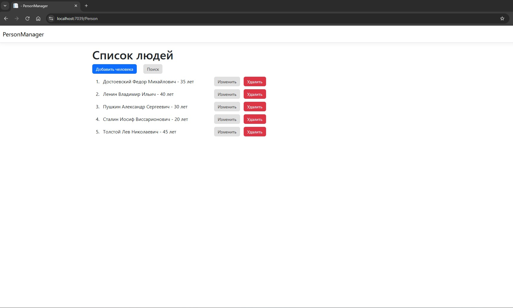
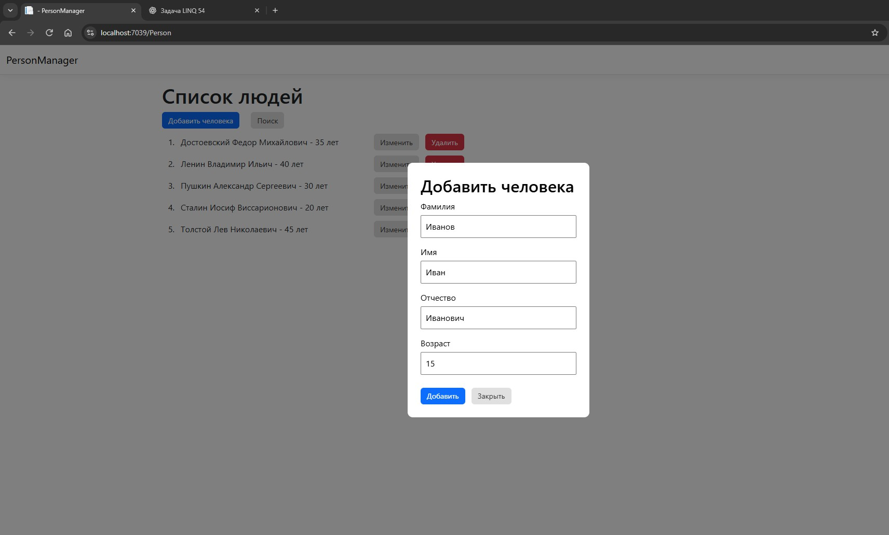
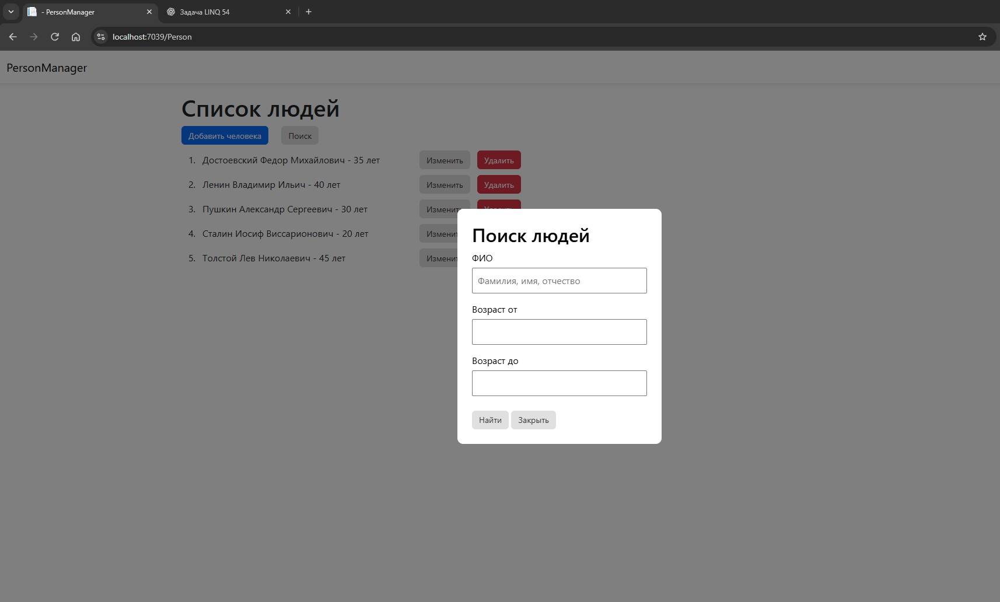

PersonManager

Учебное веб-приложение для управления списком людей, разработанное на C# и ASP.NET Core MVC.

О проекте

Приложение позволяет управлять записями о людях: добавлять, редактировать, удалять и искать записи. Данные хранятся в PostgreSQL, работа с базой данных реализована с помощью Entity Framework Core.

Функциональность

Добавление, редактирование и удаление записей.

Валидация введённых данных.

Поиск по имени без учёта регистра.

Фильтрация по возрасту.

Сортировка по имени.

Модальные окна для добавления и редактирования записей.

Технологии

C#

ASP.NET Core MVC

Entity Framework Core

PostgreSQL

Npgsql

LINQ

Razor Views

HTML, CSS, JavaScript

Запуск проекта

Установить .NET SDK и PostgreSQL.

Клонировать репозиторий:

git clone https://github.com/Boobonick89/PersonManager.git

Открыть решение в Visual Studio.

Настроить строку подключения к PostgreSQL в конфигурации приложения.

Восстановить NuGet-пакеты.

Применить миграции Entity Framework Core, если они предусмотрены проектом.

Запустить приложение.

Статус

Учебный проект для практики разработки веб-приложений на C# и ASP.NET Core MVC.

## Скриншоты приложения

### Список людей

### Добавление человека

### Поиск и фильтрация

